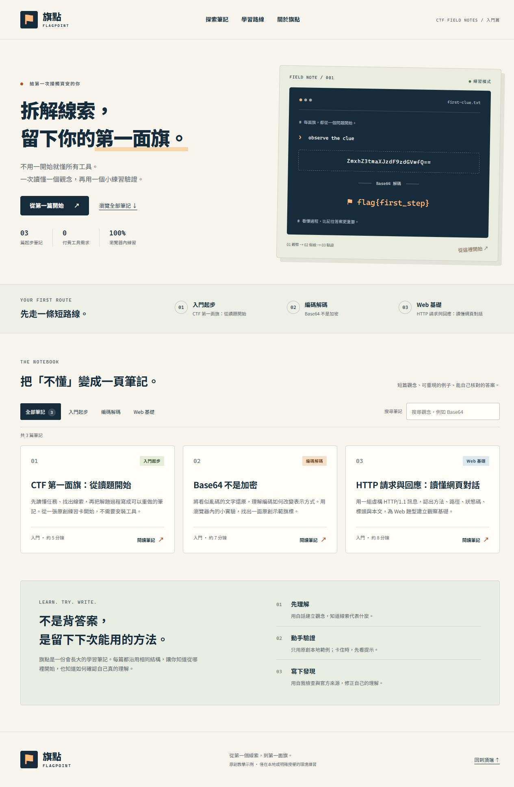

# 旗點 Flagpoint

**從第一個線索，到第一面旗。**

旗點是一個繁體中文 CTF 初學者筆記站。每篇以一個小觀念為起點，搭配原創示範、可自行核對的練習，以及自我檢查題，幫助讀者把「看過」變成「能說明」。

這個專案也示範如何用 [AGENTS.md](AGENTS.md) 建立可重複使用的 AI 協作規則：新增一份符合規格的文章資料，就能產生新的內容頁並更新首頁目錄，不必重新設計頁面。

## 發布狀態與入口

公開 repository 與 GitHub Pages 已於 2026-11-05 驗證。首頁、三篇文章與所有共用資源均回應 HTTP 200。

- Repository：[J10419/flagpoint-ctf-notes](https://github.com/J10419/flagpoint-ctf-notes)
- 網站：[旗點 CTF 初學者筆記站](https://j10419.github.io/flagpoint-ctf-notes/)
- 實際驗證紀錄：[evidence/verification.md](evidence/verification.md)
- 規則與實作對照：[evidence/rule-mapping.md](evidence/rule-mapping.md)
- 作業繳交文案：[SUBMISSION.md](SUBMISSION.md)



## 網站內容

| 筆記 | 核心觀念 | 來源檔案 |
| --- | --- | --- |
| 第一面旗 | 認識 CTF、閱讀題目與記錄解題過程 | [first-flag.json](content/notes/first-flag.json) |
| Base64 不是加密 | 區分編碼與加密，動手解碼文字 | [base64-basics.json](content/notes/base64-basics.json) |
| HTTP 請求與回應 | 從一段原創文字對話看懂請求與回應 | [http-basics.json](content/notes/http-basics.json) |

首頁提供搜尋與分類；文章有固定閱讀順序、頁內目錄、收合式提示與答案、自我檢查。Base64 筆記附瀏覽器內解碼實驗，輸入不會傳送到伺服器。

全文與一般導覽不依賴 JavaScript。搜尋、分類、測驗與解碼實驗需要啟用 JavaScript；本站沒有帳號、後端、資料庫、進度儲存或追蹤功能。練習是自製教學示範，不是真實競賽題目；外部參考頁不屬於本站，可能隨時間調整。

## 本機使用

需要 Node.js 22 以上。專案沒有第三方套件，不必執行 `npm install`。

在專案資料夾執行：

```sh
npm test
npm run build
npm run serve
```

開啟 <http://127.0.0.1:4173>。預覽結束時，在啟動預覽的終端機按 `Ctrl+C`。

`docs/index.html` 可以直接開啟閱讀，但瀏覽器可能限制 `file://` 下的 JavaScript module。要操作完整互動功能，請使用本機 HTTP 預覽或已發布的網站。

## 目錄與維護邊界

```text
flagpoint/
├─ AGENTS.md                 AI 必讀規則與完成標準
├─ README.md                 使用、維護與發布說明
├─ SUBMISSION.md             作業繳交文案
├─ package.json              建置、測試、預覽指令
├─ content/notes/            文章的唯一資料來源
│  ├─ first-flag.json
│  ├─ base64-basics.json
│  └─ http-basics.json
├─ templates/note.json       完整的新增文章範本
├─ src/assets/               共用樣式、互動邏輯與圖示
├─ scripts/                  建置、資料驗證與預覽程式
├─ tests/                    Node 內建測試
├─ docs/                     產生的靜態網站，提交並供 Pages 發布
│  ├─ index.html
│  ├─ notes/
│  └─ assets/
└─ evidence/                 規則對照與實測紀錄
```

只修改 `content/notes/`、`src/` 或 `scripts/` 等來源；**不要直接修改 `docs/` 的文章或樣式**。建置後將來源與更新的 `docs/` 一起提交。

## 新增一篇筆記

1. 先讀 [AGENTS.md](AGENTS.md) 與一篇既有文章。
2. 將 `templates/note.json` 複製為 `content/notes/<slug>.json`。例如新增 URL 編碼筆記，可使用 `url-encoding.json`。
3. 填好全文、練習、測驗及查證過的官方來源。`slug` 與檔名一致，`order` 不得與既有文章重複。
4. 執行 `npm test`、`npm run build`、`npm run serve`。
5. 確認首頁自動出現新卡片，文章、分類與搜尋可用，再檢查窄螢幕、鍵盤操作、提示及答案。
6. 檢視差異，提交來源與 `docs/`；依實際結果更新驗證紀錄。

範本本身是一篇完整的 URL 編碼示例，放在 `templates/` 時不會發布。自動測試會把它加入暫存的內容集合，檢查「只增加一份資料就產生第四篇筆記」的擴充流程。

### 固定內容格式

完整約束以 [AGENTS.md](AGENTS.md) 與 [validate.mjs](scripts/validate.mjs) 為準。

| 欄位 | 填寫方式 |
| --- | --- |
| `slug` | 唯一的小寫英文 kebab-case，與 JSON 檔名一致 |
| `title`、`summary` | 繁體中文標題與 20–120 字元摘要 |
| `category` | `start`、`encoding`、`web` 三選一 |
| `difficulty` | `入門` |
| `minutes`、`order` | 估計閱讀分鐘數 1–30；唯一且大於 0 的排序整數 |
| `updated` | 有效且不晚於當日的 `YYYY-MM-DD` 日期 |
| `prerequisites`、`objectives` | 至少一項非空字串 |
| `sections` | 依序包含 `overview`、`concepts`、`walkthrough`、`pitfalls` |
| `practice` | 題目 `prompt`、提示 `hint`、答案 `answer`、解釋 `explanation` |
| `quiz` | 題目、3 個不同選項、正確答案索引 0–2、解釋 |
| `references` | 至少一筆官方 HTTPS 來源的標題與網址 |
| `lab` | 選填；僅允許 `base64` |

每節的 `blocks` 可使用段落、清單、程式碼或提醒四種型別。內容為純文字，不內嵌 HTML 或 Markdown。共用產生器負責 HTML 跳脫、版面、導覽與相對路徑。

### 可以交給 AI 的指令

> 請先讀 AGENTS.md，依 templates/note.json 新增一篇 URL 編碼入門筆記，slug 為 url-encoding、category 為 encoding、order 為 40。使用官方來源與原創本地示例，保留固定章節、提示與答案及自我檢查。完成後執行 npm test 與 npm run build，確認首頁自動加入文章，回報變更、測試結果與尚未完成事項。

新增分類或區塊型別時，必須同步更新規則、範本、驗證器、產生器與測試，避免文件與網站各自演變。

## 測試與規則對應

`npm test` 使用 Node 內建測試工具，檢查內容欄位與命名、產生的頁面結構及站內連結、可重現建置、文字跳脫、搜尋與分類、Base64 解碼、測驗判定，以及新增範本文章的擴充情境。

自動測試不能取代視覺、鍵盤或公開網址檢查。各項實際執行結果與限制記錄在 [verification.md](evidence/verification.md)；規則對照位於 [rule-mapping.md](evidence/rule-mapping.md)。這兩份文件協助維護者分辨「規則要求」與「已取得的驗證證據」。

## 發布到 GitHub Pages

1. 在 GitHub 建立公開 repository，將本專案完整推送至 `main`，包含建置後的 `docs/`。
2. 開啟該 repository 的 **Settings → Pages**。
3. **Build and deployment → Source** 選擇 **Deploy from a branch**。
4. Branch 選 **main**，資料夾選 **/docs**，按 **Save**。
5. 等待 Pages 部署完成，再開啟 GitHub 顯示的實際網址。
6. 檢查公開首頁、三篇文章、樣式、互動及來源連結，將實際網址與結果更新到本文件、`SUBMISSION.md` 及驗證紀錄。

之後新增筆記，先測試與建置，再將來源及 `docs/` 推送至 `main`。Pages 會依設定發布更新。發布來源設定依據：[GitHub 官方文件](https://docs.github.com/en/pages/getting-started-with-github-pages/configuring-a-publishing-source-for-your-github-pages-site)。

登入、雙重驗證或帳號授權由帳號擁有者完成，不要在聊天、程式碼或 repository 中貼上密碼與 token。遇到阻擋時，保留可用的本地成果並記錄未完成的發布步驟。

## 原創與 AI 協作說明

本專案使用 AI 協助設計規則、撰寫程式、整理原創教學例子與執行檢查。技術事實列出官方來源，示例不冒稱真實賽題或作者的實戰經驗。繳交者應親自閱讀規則、操作網站並確認教材內容，填入自己的繳交資料；不能把 AI 的產出或自動測試視為已證明所有內容正確。
